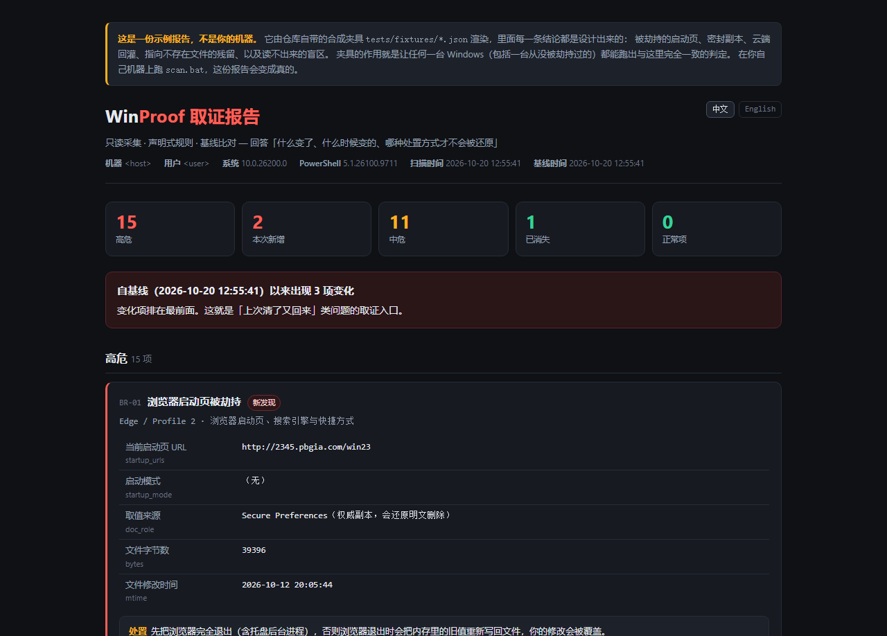
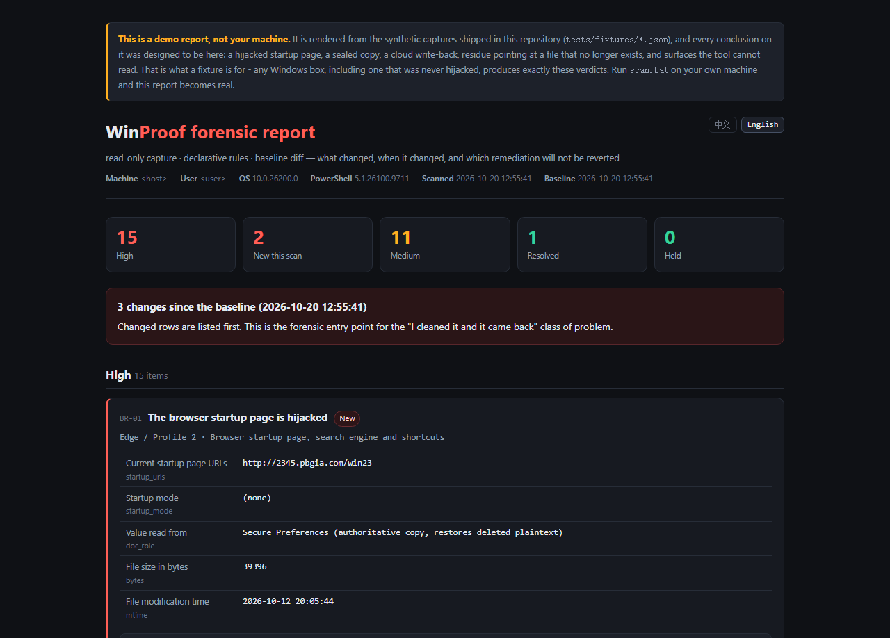

# WinProof · Windows 驻留取证与基线比对

[](https://github.com/xuange-hu/winproof/actions/workflows/ci.yml)
[](https://xuange-hu.github.io/winproof/demo/)
[](https://github.com/xuange-hu/winproof/releases)


**Read this in English: [README.md](README.md)**（同一份内容、同一批数字，英文版是主文档）

> 不是又一个"清理工具"。它回答的是清理工具回答不了的那三个问题：
> **什么东西变了 · 什么时候变的 · 你刚才那个处置方式会不会被还原。**

**没有 Windows 也能先看一眼它长什么样 → [在线示例报告](https://xuange-hu.github.io/winproof/demo/)**
（由仓库自带的合成夹具渲染，页面上明确标注了是示例，不是你的机器）

零依赖：只要 Windows 自带的 PowerShell 5.1。不装 .NET SDK、不装 Node、不联网、不上传任何东西。
双击 `scan.bat` 就出一份自包含的 HTML 取证报告。

---

## 为什么需要它：两次修复，两种结局

我的 Edge 启动页被 `2345.pbgia.com` 劫持，我处置过两次（10-10、10-16），两次都被还原——但**还原的原因不同**，
而这两个原因都是可以在文件里观测到的。这是本项目存在的理由。

| | Edge / Profile 1 | Chrome / Default |
|---|---|---|
| 修复备份 | `bak_20261010-221049` · 71,212 B · 含恶意 URL | `bak_20261010-152128` · 30,814 B · 含恶意 URL |
| 第一次处置（10-10，只删明文键） | **复发** | **保持干净** |
| 差别 | 4 个 `*_edge_enclave` 密封键 + `_verify` | 无密封副本 |
| 第二次处置（10-16 14:18，删明文键 **并且**删掉整个密封键族） | **还是复发**：15:55:30 Edge 后台进程启动，15:55:40 `restore_on_startup=4` + 恶意 URL 重新落盘（148,932 B） | 不适用 |
| 复发时磁盘上还有没有这份值 | 没有——明文 `Preferences` 的 `session` 是空的，密封键也已被删 | — |
| 所以来源是什么 | `sync.preferences` = 开 ⇒ **云端配置把它灌回来的** | — |
| 结论 | **文件级修复在这类 Profile 上只能顶到下一次浏览器启动**，必须走 `edge://settings/onStartup`，让云端副本一起被改掉 | **修复保持**（BR-07） |

同一个处置动作，在三个结构不同的对象上得到三种结果：**没被还原**、**被本地密封副本还原**、
**被云端还原**。而在文件层面，三者的"删掉了"看起来一模一样。

> 市面上没有工具报告这件事，因为它们都只做一次快照式的"扫描—删除"。
> WinProof 把**基线**做成一等公民：`baseline.bat` 固化此刻的状态，之后每次 `scan.bat`
> 把每条结论分类成 `新发现 / 已变化 / 持续存在 / 已知 / 已消失`。
> 上面那条时间线不是我手写的：它来自探针读到的 `.bak_` 备份文件名里的时间戳、两个文档各自的
> `mtime`，以及备份文件**内部**的 `startup_urls` 值——修复动作留下的痕迹本身就是证据。

> 基线**永不自动更新**。否则往你机器里写东西的那位，只要等你重新采集一次基线就把自己洗白了。

---

## 30 秒上手

不想 clone：到 [Releases](https://github.com/xuange-hu/winproof/releases/tag/v1.1.0) 下
`winproof-1.1.0.zip`（388 KB，解压即用；CI 每次都会验证这个包里三个 `.bat` 全是 CRLF，
因为一个 LF-only 的批处理会被 cmd 执行一半，然后在你的机器上报一个跟真因无关的语法错误）。

```
scan.bat                       # 只读采集 + 求值 + 生成 out\report.html 并打开
baseline.bat                   # 把当前状态固化为参照点（第一次用完它再决定要不要留）
ack.bat "BR-06|Edge / Profile 1"   # 「这是我自己的配置，别再报」——不删规则，只降级这一条
```

`ack.bat` 那条命令里同时有引号、竖线和空格，在 cmd 里手敲很容易静默打错，
所以报告里每张卡片底部直接给了一个**可点击复制的完整命令**（点一下变成「已复制 ✓」，
复制失败会说「复制失败，请手动选中」——一个谎称自己复制成功了的按钮比没有按钮更糟）。

报告长这样（真机截图，已脱敏）。想点筛选、展开证据、看折叠的判据说明，就去
[在线示例](https://xuange-hu.github.io/winproof/demo/)——那份是从仓库自带的合成夹具渲染的，
所以它同时演示了"修好又回来"这类在干净机器上根本拍不到的状态：



同一份报告、同一次扫描，也可以整页读成英文——语言在打开文件那一刻决定（跟随系统，
可用 `?lang=en` / `?lang=zh` 覆盖，页头有切换按钮）：



---

## 检测清单：19 条规则，每条都能被复述成一次具体观察

不是"清单长所以显得全"。每条规则后面写的是**它在你机器上长什么样**——
`rules/*.json` 里的 `verified_evidence` 字段必须填作者本人跑出来的命中数和对象名，否则不进主干。

**浏览器启动页、搜索引擎与快捷方式**（11 条）

| 规则 | 严重度 | 判据一句话 | 为什么单独列出来 |
|---|---|---|---|
| BR-01 | 高危 | `session.restore_on_startup=4` 且 `startup_urls` 命中域名黑名单 | 不改 hosts、不装服务、不在任务管理器里，只写两个 JSON 键 |
| BR-02 | 高危 | 存在 `*_edge_enclave` / `*_edge_lightweight` 密封键族 | **手工清理失败的真正原因**：明文删干净了，另一份副本被当成权威源还原回来 |
| BR-03 | 观察 | 启动模式=4（打开特定页面）但 URL 不在黑名单 | 单独看不算劫持，和 BR-01 一起看才是"有人改过这里" |
| BR-04 | 中危 | `protection.macs` 里有签名、明文键却没了 | 篡改者不必伪造签名——删值留签名就足以让浏览器认为这段是权威的 |
| BR-05 | 高危 | 当前值命中黑名单，且修复备份里也命中、且当前文件更新 | 一次性扫描器答不出"我上次清了，它为什么还在"；这条把两次时间戳放在一起 |
| BR-06 | 低危 | `profile.exit_type != Normal`（非阻塞加锁探测，不看进程名） | 后台常驻进程让"进程名 = 在用"永远误判；独占打开失败才是证据 |
| BR-07 | 正常 | 修复备份里含恶意值，当前明文已干净 | 唯一能证明"处置方式对了"的信号；其余工具只会说"已删除" |
| BR-08 | 中危 | `content_settings.exceptions` 台账里有黑名单源 | 权限、Cookie、`media_engagement` 都是**页面真被加载过**的留痕，明文删掉后它们还在 |
| BR-09 | 中危 | 默认搜索引擎的 `keyword`/URL 命中黑名单，**或** `enforced_by_policy=true` | 启动页决定你打开浏览器看到什么，搜索引擎决定你搜什么出来什么——后者只在真搜索时才暴露。策略强制那一半把"你自己装错了"和"有东西替你决定了"分开，处置方式完全不同 |
| BR-10 | 观察 | 这个对象上有本工具**读不到**的表面（引擎存成哈希、没有 Secure Preferences、JSON 解析失败） | 一个只报问题的扫描器，它的"没查到"没有信息量——无法区分"这台机器干净"和"这台机器上的东西我没覆盖到"。这条把覆盖边界变成一条会随基线变化的结论 |
| BR-11 | 高危 | 桌面 / 开始菜单 / 任务栏固定项里的浏览器 `.lnk`，参数里挂着命中黑名单的 URL | 劫持不止住在配置文件里：改掉快捷方式本身，**从这个图标启动就必然打开那一页**，不碰任何 Profile 键，配置文件级的清理工具看不见它；而且你在设置页里修好的 BR-01，会被它下一次点击悄悄覆盖 |

**开机驻留：启动项、服务、驱动与网络层**（8 条）

| 规则 | 严重度 | 判据一句话 | 为什么单独列出来 |
|---|---|---|---|
| PS-01 | 中危 | Run 键 / 服务 / 计划任务指向已不存在的文件 | 卸载残留比恶意软件常见得多，且它让"我有 40 个启动项"这个指标彻底失去意义 |
| PS-02 | 中危 | 每次开机都跑的二进制没有有效 Authenticode 签名 | 用签名者归属，不用厂商关键词黑名单——关键词只能抓到别人已经写进去的那几家 |
| PS-03 | 高危 | `Group=Early-Launch` 里出现 `WdBoot` 之外的成员 | 本机实测威胁模型：360 下载器塞过 `360elam64.sys`，BOOT_START，比普通驱动早一个启动阶段 |
| PS-04 | 高危 | hosts 里有非 `localhost` 的映射 | 不需权限、不需驻留进程，改完一直生效，而且多数清理工具根本不检查 |
| PS-05 | 高危 | IFEO 下存在 `Debugger` | 破坏力最大的单点驻留：只对具名进程生效、进程列表看不出异常、需要管理员权限才能写 |
| PS-06 | 高危 | Winsock LSP 提供方不是系统 DLL | 这个位置条目少、变动少，所以一条非系统提供方是很硬的信号 |
| PS-07 | 低危 | 常驻二进制位于用户可写目录（精确排除三个微软签名名） | 必须排除微软签名，否则 Defender 自己的 `MpCmdRun` / `MsMpEng` 会被报成可疑 |
| PS-08 | 高危 | 开机命令行的参数里以明文存着口令（`rasdial … 账号 密码`、`net user … 密码`，或 `--password=`/`token=` 这类 flag） | 杀毒和启动项管理器都不读一条命令的**参数**——哪怕这个命令本身签名合法。探针只随结论带一份脱敏副本（`cmd_masked`），所以这条报得出泄露、却从不用把口令搬进报告 |

黑名单目前 9 个 token（`2345` `pbgia` `hao.360` `mydown` `so.com` `360safe` `duba` `haosf` `win23`），
在 `rules/browser.json` 里是数据不是代码，换机器、加域名都不用碰引擎。它用的是**子串匹配**，
所以你主动把 `so.com` 设成首页也会被报——正确处置是 `ack.bat` 标记为已知，而不是把规则调瞎。

`BR-11` 复用同一份黑名单，所以它没有引入任何新的判断。它新增的是**一个表面**：探针用 `WScript.Shell`
走一遍桌面、两个开始菜单目录和任务栏固定项文件夹，只保留目标是浏览器可执行文件的快捷方式，
再把参数里的 URL 读出来。这类对象的 subject 前缀是 `browser_shortcut`，是**机器级**而不是每个 Profile
一条——所以报告里的对象总数是"Profile 数 + 快捷方式数"。

---

## 这台机器上它实际报了什么

```
engine: subjects=69 rules=19 findings=27 high=4 resolved=2
counts: NEW=9 CHANGED=4 PERSIST=14 KNOWN=0 RESOLVED=2
```
（10-20 重扫。基线是 10-15 拍的，所以上面这些状态全是"相对五天前"的判断，不是"相对昨天"。
`subjects=69` = 59 条自启动对象 + 5 个浏览器 Profile + 5 个浏览器快捷方式。）

| 严重度 | 规则 | 命中 | 对象 |
|---|---|---|---|
| 高危 | BR-01 启动页被劫持 | 1 | Edge / Profile 1 —— 状态 `已变化`，就是上面那次云端回灌 |
| 高危 | BR-02 存在密封副本，只删明文会被还原 | 2 | Edge / Default、Edge / Profile 1 |
| 高危 | BR-05 清理后又回来了 | 1 | Edge / Profile 1 |
| 中危 | BR-04 签名孤儿（此处曾被篡改并清理过） | 4 | Edge ×3、Chrome ×1 —— 其中 Edge / Profile 是这次**新出现**的 |
| 中危 | BR-08 黑名单域名仍持有内容设置例外 | 3 | Edge / Profile 1、Edge / Default、Chrome / Default —— 三条都从"已变化"变成了"新增"，因为台账本身在基线之后缩小了 |
| 中危 | PS-01 自启动项指向已不存在的文件 | 2 | service / AndrowsSvr、service / Everything（10-15 之后**新增**：卸载把服务留下来了） |
| 中危 | PS-02 开机自启程序无有效签名 | 2 | Authenticator、OpenClaw Gateway |
| 低危 | BR-06 浏览器上次不是正常退出 | 1 | Edge / Profile 1 —— 状态 `已变化`（Chrome / Default 这次转为 `已消失`，见下） |
| 低危 | PS-07 常驻程序位于用户可写目录 | 5 | Rd_Service、3 条 WPS 任务、OpenClaw |
| 观察 | BR-03 启动模式被设为"打开特定页面" | 1 | Edge / Profile 1 |
| 观察 | BR-10 本工具在这个对象上有判定盲区 | 4 | Edge 的 4 个 Profile：默认搜索引擎存成了哈希，读不出 |
| 正常 | BR-07 上次修复经受住了复查 | 1 | Chrome / Default |

**`PS-08` 不再报了，而"它是怎么消失的"这件事本身就是关于基线的一课。**
计划任务 `\自动拨号` 原先在 `rasdial` 的参数里明文存着宽带账号和口令。10-20 把参数改成了
`rasdial "<连接名>"`，凭据改由电话簿提供（那是 LSA secret，由 RAS 服务在自己的上下文里读），
世界可读的任务 XML 里不再有口令。但这一条在上表里**不是**以"已消失"出现的：`PS-08` 是 10-19 写的，
晚于 10-15 那次基线，所以基线里根本没有它的记录可供退役——它只是不再命中了。
一条结论必须先被基线记录过，才有资格被报成"已消失"。
"这个问题停了"和"这个问题从没被测过"，是两件事，报告必须能说出这个差别。

**`已消失` 这一栏一直在动，而这正是重点。**
`BR-06 / Chrome / Default` 这四次扫描已经来回翻过：报出 → 消失 → 又变回 `已变化`（`exit_type=Crashed`）
→ 这一轮又 `已消失`，因为探针读到它的那一刻 Chrome 恰好是干净关闭的。这不是噪声——**"消失"不是终点，
它是一条会被再次推翻的结论**，这恰恰是基线比对存在的意义，也是引擎从不自动把它固化进基线的原因。
另一条 `PS-02 / run_key / Lively` 仍然消失着，而且它是真的到底了：那个自启项是我自己删的，删掉就是删掉了。
一个只会列当前问题的工具说不出这两种区别。

**BR-09 命中 0 条，而 BR-10 命中 4 条，这两句要一起读。** Chrome / Default 的
`default_search_provider_data.template_url_data` 是明文对象（keyword=google.com、
enforced_by_policy=false），所以"这台机器的 Chrome 搜索引擎没被换过"是一句**查过了**的结论；
Edge 的 4 个 Profile 同一位置存的是 40 位十六进制哈希加 `_encrypted_hash`，读不出引擎，
所以那 4 条 BR-10 说的是"这里我没查"。如果只报"0 条 BR-09"，这两种情况在报告里长得一样。

**BR-11 本机命中 0 条，而且支撑这个 0 的 5 行数据是列得出的。**
探针扫到 5 个浏览器快捷方式：4 个参数里根本没有 URL（`Microsoft Edge.lnk`、`Google Chrome.lnk`
两个裸启动，另两个只带 `--profile-directory=Default` / `Profile 1`），1 个是 GitHub 的 PWA 启动器，
参数里有 `--app-url=https://github.com/`。没有一个命中黑名单，所以这条在本机是空转的——
这也正是它的已知答案测试必须落在合成夹具上的原因：夹具里种了一条
`http://www.2345.com/?cid=win23`，另外两条邻居保持干净。作者机器上从没命中过的规则，
只有靠可复跑的测试才谈得上可信。

**PS-03 / PS-04 / PS-05 / PS-06 命中 0 条，这是正确状态而不是漏报。**
Early-Launch 成员只有 `WdBoot`、hosts 只有 `127.0.0.1 localhost`、IFEO 下没有 `Debugger`、
5 个 Winsock LSP 全是微软签名的系统 DLL。每条规则的 `verified_evidence` 都写明了本机实测分布，
所以"命中 0"是可以被复核的，不是"这条规则大概没写好吧"。

---

## 架构：五层，各层职责不重叠

```
probes/    只读采集事实，不做任何判断
rules/     纯 JSON 数据，没有代码、没有 eval
engine.ps1 声明式谓词解释器 + 基线 diff
report.ps1 生成自包含静态 HTML，没有服务器
tests/     提交的合成采集夹具：判据的可执行定义
```

**规则不是代码，这是本项目的核心决策。**

一条规则长这样：

```json
{
  "id": "PS-07",
  "title": "常驻程序放在用户可写目录",
  "severity": "low",
  "when": { "all": [
    { "fact": "exe_exists",  "op": "eq",     "value": true },
    { "fact": "in_writable", "op": "eq",     "value": true },
    { "fact": "signer",      "op": "notIn",  "value": ["Microsoft Windows", "Microsoft Windows Publisher", "Microsoft Corporation"] }
  ]},
  "show": ["kind", "exe", "signer", "sig_status", "exe_mtime", "exe_bytes"]
}
```

条件是一个受限 AST，算子集合固定为 `eq / ne / nonEmpty / isEmpty / hasAny / countGte / in / notIn`，
未知算子直接 `throw`。这意味着：

- 从 PR 里合进来的一条规则、或者大模型帮你生成的一条规则，**永远不会变成可执行输入**——注入面为 0；
- 规则可以被静态检查、被 diff、被机器校验，而不是"读代码才知道它会不会 `Invoke-Expression`"；
- 加一条判据不用碰引擎。

`when` 决定命中，`show` 决定哪些字段进入**证据指纹**。指纹只由 `show` 列出的字段算出，
所以一个文件被改写、但相关证据没动时，这条结论仍然是 `PERSIST` 而不是 `CHANGED`——
否则一次浏览器启动会把该 Profile 上所有规则全部点亮，"什么变了"就又被噪声淹没了。

**两份措辞，一次求值。** 报告是中英双语的，而"语言在哪一层被决定"是一个设计选择，不是细节：
每条规则在自己的 JSON 里带一份 `i18n.en` 措辞，引擎在算指纹的同一次求值里把它挂到结论上，
渲染层在**打开页面时**才选语言（跟随 `navigator.language`，可用 `?lang=` 覆盖，页头有切换按钮）。
由此得到四条：

- 覆盖层只能放 `title / advice[] / why / verified_evidence`，看不到 `when`、`show`、`severity`——
  所以**翻译改不动命中结果**。这一点不是嘴上说的：`selftest [16]` 把引擎和规则文件复制到临时目录，
  只改英文措辞再跑一遍，要求两次指纹逐字节相同。
- `findings.json`、`store\baseline.json` 和所有指纹都不含语言。一次扫描服务两种语言，
  改一个英文错别字不会让 30 条 `PERSIST` 变成 `CHANGED`。
- 处置建议按分支下标选取，英文那份跟着**同一个下标**——条件分支由事实决定一次，不按语言各算一遍。
- 覆盖层在**加载规则时**校验：缺 `i18n.en`、或翻译条数少于规则本身的分支数，直接 `throw` 中止。
  一份中英夹杂的报告比一份构建失败的报告更难被反驳。
- 脚本完全没跑起来时，页面仍然是一份完整的中文报告——兜底是一种语言，不是白屏。

---

## 踩过的坑，以及它们如何变成判据

这些不是感想，每一条都对应一段现在还活在代码里的逻辑。

**1. `Secure Preferences` 和 `Preferences` 得合起来看。**
被劫持的值在 `Secure Preferences` 的 `session.startup_urls`，
而决定"手改文件会不会被云端回灌"的 `sync.preferences` 在另一个文件的 `sync` 段里。
单看任何一个文件都会给出错误的处置建议。引擎按 Profile 合并两份文档，
派生出 `sync_preferences_enabled` 再喂给规则。

**2. 明文键名在两个文件里不一样。**
`Secure Preferences` 用 `restore_on_startup`，纯 `Preferences` 用 `startup_setting`。
只查一个就会漏。

**3. 密封副本必须整族删除。**
Edge 在 `session` 下另存 `startup_urls_edge_enclave` / `_verify`（另一台机器上是 `_edge_lightweight`）。
只删明文，Edge 下次写文件时从密封副本还原——这正是上面那格"复发"的成因。
所以规则匹配的是 `_(edge_enclave|edge_lightweight)(_verify)?$` 整个键族。

**4. `protection.macs` 是两层的：段名 → 键名 → 签名。**
而且这些签名是**确定性**的：`Default` 和 `Profile 2` 对同一个不存在的值有一模一样的签名字节。
也就是说篡改者不需要伪造任何东西——删掉值、留下签名，就是本机 `BR-04` 报的"签名孤儿"。
它不是当前威胁，是历史证据：说明这个位置被改过并清理过。

**5. 用签名者归属，不用厂商关键词黑名单。**
关键词列表只能抓到别人已经写进列表的那几家。
"这个每次开机都跑的二进制没有有效签名"抓的是**你机器上实际存在的东西**。

**6. `Microsoft Windows Hardware Compatibility Publisher` 不是微软的软件。**
它是 WHQL 第三方签名通道。一开始我把它当成微软签名，导致一批第三方驱动被放过。
`PS-07` 的排除列表因此是精确的三个名字，不是一个 `startswith("Microsoft")`。

**7. `PS-07` 必须排除微软签名，否则 Defender 自己会被报成可疑。**
`WinDefend` 和 `MDCoreSvc` 的真实二进制就在 `C:\ProgramData\Microsoft\Windows Defender\` 下。
自检里这条被**正向断言**：先确认本机确实存在"微软签名 + 可写目录常驻"的对象（2 个），
再断言它们一个都没漏进 `PS-07`。少了前半句，这个断言可以永远空转通过。

**8. 裸命令名不是丢失的文件。**
`scheduled_task\自动拨号` 的命令行是 `rasdial <连接名> <账号> <密码>`。
第一版把它报成"目标文件已不存在"——假阳性。`CreateProcess` 是按 `PATH` 解析裸名的，
它指向 `C:\Windows\System32\rasdial.exe`，活得好好的。
补上 `Resolve-BareCommand` 之后 `PS-01` 从 2 条降到真实的 1 条。
（顺带：那行命令行里存着明文拨号密码。修掉解析缺陷之后它不再进报告，
`verify.js` 现在会从事实文件里取出这些 token 并断言它们没出现在 HTML 里。）

**9. `\SystemRoot\...` 相对 ImagePath 要展开。**
不展开的话 `WdBoot` 看起来是"丢失的文件"，残留规则会打在 Defender 身上。

**10. 带空格的未加引号路径不能按第一个空格切。**
注册表里 `"C:\Program Files\...\x.exe"` 这种值，要把 token 逐个拼回去试 `Test-Path`，
拼不上再按扩展名兜底——第二个判据保证一个真丢了的文件仍归属到完整路径，而不是 `C:\Program`。

**11. `countGte` 对标量取的是数值，不是"数组长度"。**
`host_effective = 0` 被当成 1 个元素，于是**每台机器都会报 hosts 被劫持**。
这是自检里 [7] 那节钉住的行为，正反两个方向都断言。

**12. PowerShell 5.1 的序列化坑。**
空数组变 `{}`、单元素数组变对象 → 渲染层统一 `norm()`；
`PSCustomObject.ToString()` 是空串 → 证据必须 `ConvertTo-Json -Compress` 再进指纹，
否则对象型证据（备份列表、密封键族）对指纹毫无贡献，基线 diff 会永久失明。

**13. `-Value [string]$x` 在参数模式下不是表达式。**
`[string]` 被当成字面量 token，值变成字符串 `"[string]@{...}.group"`，
后续哈希查表全部落空 → 报告里每张卡片的分组名静默为空。必须写 `-Value ([string]$x)`。
这个 bug 是靠截图发现的，现在 `selftest [12]` 直接断言 `group_title` 非空且不含 `@{`。

**14. 一台干净的机器测不到那四条最危险的规则。**
`PS-03`（ELAM）、`PS-04`（hosts）、`PS-05`（IFEO）、`PS-06`（LSP）在本机命中 0 条——这是正确结果，
但也意味着真机自检永远不会执行它们：谓词写反了也只有出事那天才知道。
`tests/fixtures/facts-persistence.json` 因此造了这四种状态各一份，
[8] 断言 8 条驻留规则**全部**命中且命中集合与清单完全一致。
同理 `BR-01/BR-05` 的"sync 开/关"两个建议分支、`PS-01` 的三个处置分支、`BR-08` 的
"启动页已干净 vs 仍在被劫持"两个建议分支，都在夹具里各有一个专属对象。
`BR-08` 还多一条：夹具在每个 Profile 里都掺了几个正常域名（google / bilibili / 一个裸 IP），
断言这些一个都不许出现在证据里——黑名单是子串匹配，这条断言就是它的护栏
（`so.com` 会匹配 `www.so.com`，但也随时可能匹配到别人的域名后缀，所以必须钉住）。

**15. 锚定文档选了却没用：只有明文 `Preferences` 的 Profile 被静默放过。**
`New-BrowserSubjects` 先算出 `$anchor = Secure Preferences ?? Preferences`，
之后却只在 `$null -ne $secure` 时读取字段——于是没有 `Secure Preferences` 的 Profile，
即使明文里写着被劫持的 `session.startup_urls`，`BR-01` 也不会报。
这是**写夹具时才暴露的假阴性**：`Chrome / Profile 3` 那条 plain-only 记录唯一的用途就是打这个点。
修法是按锚定文档取值，同时把密封键/孤立签名继续锁在 secure 文档里（它们本来就只存在于那儿），
所以 plain-only Profile 不可能凭空报出"存在密封副本"。
`BR-01`/`BR-03` 的 `doc_role=secure` 前置条件也一并去掉，并把 `doc_role` 放进证据——
读者需要知道这个值是从哪份文档读来的，因为"手改会不会被还原"取决于它。

**16. 规则可以引用一个渲染层没翻译的字段。**
`PS-03/05/06` 的 `show` 里有 `name`，但模板的标签表没有它。
本机上这三条规则命中 0 条，所以真机报告**永远看不到**这个空格子——
直到某台机器真的中 ELAM 为止。`verify.js` 现在遍历 `rules/*.json` 的所有 `show` 字段，
断言每一个都在模板标签表里有中文条目，命中与否无关。

**17. `Get-Content -Raw` 在 5.1 里是按 ANSI 码页解的。**
CI 里那步"建基线→立刻复扫→断言 `counts.NEW == 0`"最初写的是
`Get-Content out\findings.json -Raw | ConvertFrom-Json`，本地一跑直接炸：
`findings.json` 是无 BOM 的 UTF-8，5.1 用 ANSI 解，中文标题变成乱码字节后连 JSON 结构都解析不动
（报"应为 : 或 }"），而文件本身完全合法。改成 `[IO.File]::ReadAllText()`。
引擎自己读文件一直用的就是 `ReadAllText`，所以这个坑只在**外围脚本**里出现——
也说明 CI 的每一步都得先在本地按同样顺序跑一遍，不能靠"看起来对"。

**18. `run: & report.ps1` 不是 PowerShell 引号，是 YAML 锚点。**
仓库推上去之后第一次 CI 绿灯变红，但**日志里一个 step 都没有**——因为
三条 `run: & xxx.ps1` 里的 `&` 是 YAML 的 anchor 指示符，整个文件解析失败，job 数为 0，
run 的标题直接显示成文件路径。修复是给标量加引号（`run: '& report.ps1'`）。
教训有两层：`&` 开头的命令务必整条加引号；以及判断 workflow 有没有跑，要看 job 列表，
不能只看 conclusion——没有 job 的 run 也会给你一个红色的叉。

**19. Actions 里 `& engine.ps1` 找不到命令，本地手敲却可以。**
`shell: powershell` 的 step 脚本工作目录是仓库根，但裸文件名不会按 CWD 解析，
必须写 `& .\engine.ps1`。这个坑是第二次红才暴露的，也正是第 18 条修复之后才走得到的那一步——
所以"先把 workflow 跑起来"本身就是一种测试。同时把断言改成自证的：
`NEW != 0` 时先把每一行 `rule_id | subject` 打出来再 throw，
否则日志里只有一句"rescan reported 3 NEW rows"，没人知道是哪三条。

**20. `Test-Path -LiteralPath` 遇到非法字符是**抛异常**，不是返回 `$false`。**
本地一直绿的 `persistence.ps1` 在 runner 上第一次就崩了：某条注册表值里的命令行带了换行/控制字符，
`Test-Path -LiteralPath` 直接 `ArgumentException: Illegal characters in path` 把整个探针带走。
修法是加一层 `Test-Target`：`try { Test-Path -LiteralPath $p -ErrorAction Stop } catch { $false }`。
更深一层是设计约束——**探针遍历的是别人写进注册表的字符串**，
"这个路径根本不成其为路径"必须是一种正常结果，不能是异常；
`Test-Path` 返回 false 的直觉在 `-LiteralPath` + 非法字符这个组合上不成立。

**21. 计划任务最后那一跳，绕不开提权。**
`\自动拨号` 把宽带账号密码明文写在 `rasdial` 参数里。把值搬进 CurrentUser DPAPI blob 之后，
把任务的 Action 换成 wrapper 这一步，`Set-ScheduledTask`、`Register-ScheduledTask`、
`schtasks /change` 三条路径全部 `0x80070005`——即使这个任务的 Author 就是当前用户。
原因是无密码的 S4U principal 需要 `SeTcbPrivilege`；
连"把 LogonType 从 S4U 改成 Interactive"这一种看起来只是降权的修改，未提权同样被拒。
所以交付形态只能是自提权的双击脚本。附带一条无法本机证伪的隐患：
S4U 上下文里 DPAPI CurrentUser 能不能解出主密钥，**不提权就测不出来**（建同类探针任务本身就要提权），
因此 wrapper 用退出码把这条不确定性变成可观测：解不出→`7`，脚本收到 `7` 立刻回滚成原明文参数形态，
宁可保留已知风险也不留下一个不会拨号的机器。

**22. "我复查过了"的证据窗口太短。**
10-16 14:18 做完文件级修复（删明文键 + 删整个 `*_edge_enclave` 键族，写盘前逐键比对其余顶层值字节一致），
随后完整启动/关闭一次浏览器复查——干净，`BR-07 正常`。
15:55:30 Edge 后台进程（Startup boost）自己起来了，**15:55:40 恶意值就回来了**，
此时明文 `Preferences` 的 `session` 是空的、磁盘上已无该值的任何本地副本。
所以"复发"的来源是 `sync.preferences` 的云端配置，而不是本地残留——
而我的复查只覆盖了"下一次我手动打开浏览器"，没覆盖"它自己起来的那一次"。
验证处置是否成立，窗口必须跨过**真正会重写这个文件的那个触发器**，
而不是跨过我最容易想到的那个动作。这也是 `BR-05` 存在的意义：它不需要我再聪明一次，
它只需要我明天再跑一遍 `scan.bat`。

**23. 分组标题里写了"搜索引擎"，代码里那条事实却是个死字段。**
`probes/browser_prefs.ps1` 早先用正则从原始文本里扫 `"search_url"|"template_url"`，
但真实的默认引擎在 `default_search_provider_data.template_url_data` 这个对象里——正则扫不到它，
于是这个字段**在本机上永远是空数组**，而报告标题一直宣称覆盖了搜索引擎。
这类缺陷最难发现：它不报错、不崩溃、不产生假阳性，只是永远给出一个"干净的"假阴性。
现在改成结构化读取，并且探针输出里直接带 `search_read=1`——一个恒为 0 的计数器和一个会变的计数器，
后者才能在 CI 日志里自证它接上了。
修这个的同时补了 `BR-10`：把"读不到"本身变成结论，因为一个只报问题的扫描器，
它的"没查到"和"这台机器确实干净"在报告里长得一模一样。

**24. `.ps1` 里的中文不只是乱码，它会吃掉解析器。**
`hygiene.ps1` 拦的是**注释里**的中文（无 BOM 时按码页解码成乱码字节）。
我这次踩的是另一层：引擎里 `blind_spots` 的**字符串字面量**写了中文，
PowerShell 5.1 直接报"表达式或语句中包含意外的标记"，而且报在**下一行**的 `if` 上——
错误位置离真正的肇事字符隔了几行，靠读错误信息找回去基本是猜。
修法是引擎只输出 ASCII 码（`engine_unreadable` 这类），措辞全部放进渲染层的 `BLIND` 映射表。
这顺带成了更好的分层：判据语言属于引擎，面向人的句子属于模板，
同一个码以后要出英文版报告只需要换一张表，不用碰任何逻辑。

**25. 一个"有没有翻译"的检查，把每一句英文都判成了中文。**
出双语就必须有一道机器闸门，最直觉的写法是 `if (/[\u4e00-\u9fff…]/.test(英文那半)) 就失败`。
我那个字符类的第一段区间起点是一个**看起来像空格、确实是 U+0020** 的字符，
于是整个区间是 U+0020–U+303F——把 ASCII 字母、数字、标点全包进去了。
这个坑的一般形式是：**一个字符类的终点如果是个汉字，它可能悄悄把整张 ASCII 表吞进来，
而源码上完全看不出来**。结果它把 128 行正确的中英对照全部判红；
而更要命的是反过来——**一页根本没翻译的内容它会放行**，因为它断言的其实是
"不含某个大块里的字符"，不是"读起来像英文"。
修法按"能被证明"的顺序来：字符类一律写成 `\u3000` 这种转义，让源码没法对自己撒谎；
然后干脆不再对源码做断言。`tools/i18n-probe.html` 把报告分别按 `?lang=en` 和 `?lang=zh`
装进 iframe，遍历每一个文本节点，只保留**在屏幕上真的占了一块位置**的那些，
量的是读者看见的措辞，而不是一个永远同时装着两种语言的文件字节。
还有第三点：这道闸门现在**故意允许**英文里出现中文——PS-08 的证据里写着任务名 自动拨号，
PS-07 的证据里写着签名者 济南快安网络科技。这些是读者要能在自己机器上照着找的值，
翻译掉就等于把证据毁了。所以真正断言的是一个比例（整段没翻译是 100% 中文，
引用一个专有名词不到 1%），外加"英文那半不许和中文那半一模一样"。

**26. 报出明文口令，却从不把它握在手里。**
PS-08 之所以存在，是因为作者自己这台机器上有个计划任务 `\自动拨号`，Action 是
`rasdial <连接名> <账号> <密码>`——一个真·明文口令，而且它签名合法、干净解析到
`System32\rasdial.exe`，所以其余每一条驻留规则都**正确地**对它保持沉默。难点不在检出，
在于把问题报出来又不把口令带进报告。三个决定撑住这一点：
- 探针只产出一份**脱敏副本**（`rasdial 宽带连接 *** ***`）和一个 `cmd_secret_kind` 分类器；
  规则的 `show` 只列脱敏字段，绝不列原始 `command`。`verify.js` 里那道专门的闸门从本地事实里
  还原出真实的拨号 token 并断言它们在报告里出现 0 次，现在还会额外判失败：任何结论引用了原始
  command，或某条 PS-08 拨号行没被脱敏。
- 脱敏是**按位置、按 flag 的，而且拒绝碰占位符。** `rasdial`/`net user` 的口令是裸的尾部参数，
  所以遮掉最后两个 token；`--password=`/`token=`/`api_key=` 这种按键遮。但以 `%`、`$`、`{` 开头的值
  （`%V`、`$env:PWD`、`${account}`）是*引用*不是口令——遮它既错、又会把一处真配置藏起来，
  所以分类器刻意跳过它们。
- 指纹是用**脱敏后**的值算的，因此"改密码"这件事被故意做成无事件：口令换了，`cmd_masked` 字节不变，
  这一行就停在 `PERSIST` 而不是翻成 `CHANGED`。暴露的是命令的*形状*而非它的值——也只有这样解读，
  才不会把每次凭据轮换都变成一次幽灵般的"这里被改过"。

---

## 已知答案测试：91 PASS / 0 FAIL

判据先于扫描逻辑定义。跑 `powershell -File tools\selftest.ps1`：

```
[1]  浏览器夹具：命中集合必须逐条等于清单            [9]  countGte 的标量语义，正反两个方向
[2]  11 条浏览器规则全部被触发                       [10] 植入一条假残留 → 必须 NEW，且不得吞掉邻居
[3]  同一份事实复扫：不得有任何 CHANGED              [11] 未知探针名必须抛错，不许静默丢事实
[4]  夹具 B：修好又回来 → NEW + 旧结论 RESOLVED      [12] 分组名/标题/建议/指纹必须完整
[5]  夹具 C：文件再次被写 → CHANGED 而非 NEW         [13] 搜索引擎必须只在受保护文档里判定，读不到要说出来
[6]  夹具 D：只点亮引用了该字段的规则                [14] 真机驻留事实 vs 独立重算的谓词
[7]  acknowledge 只降级不删规则                      [15] 每条"残留"都要独立复核为确实不存在
[8]  驻留夹具：8 条规则全触发，含干净机器上闲置的那 5 条
[16] 英文覆盖层必须完整、分支对齐，并且进不了指纹
```

**[1]–[13] 与 [16] 跑在 `tests/fixtures/` 里两份提交的合成采集上，换任何一台 Windows 结果都一样**——
包括一台从没被劫持过的机器、一台没装浏览器的机器、以及 CI 里的一次性 runner。
[14][15] 跑在 `out\` 下的真机采集上，缺文件时输出 `SKIP` 而不是失败（当前 0 SKIP）。
编号按加入顺序排，所以一节夹具测试排在最后：把 [14][15] 挪号会打断上面所有对它们的引用。

夹具不是快照。清单 `$wantBrowser` / `$wantPers` 把每条规则映射到"这个夹具应当命中的对象集合"，
`Check-Manifest` 双向断言：既不许少，也不许出现清单之外的结论（`no finding outside the manifest`）。
所以往 `rules/` 里加一条规则，如果它在夹具上意外点亮了别的对象，测试会红。

`BR-11` 是第一条把**反例**单独做进夹具、而不是只靠清单兜住的规则：夹具里有 3 个快捷方式，
1 个被劫持、2 个干净（一个没有 URL，一个带合法的 `--app-url` PWA 启动器），[1] 因此额外断言
"命中集合恰好是那一个"。这一步不可省——如果匹配逻辑被写成"快捷方式只要有 URL 就算"，
清单检查照样会通过，而这条规则已经瞎了。

[13] 钉住 `BR-09`/`BR-10` 这对新规则的语义边界：默认搜索引擎是 Chromium 的**受保护偏好**，
只可能落在 `Secure Preferences` 里，所以夹具里那两条 plain-only 记录即使写着 `2345.com` 也**不许**被报成
"引擎被换过"（那会是凭空指控）；同时反向断言：一个可读且干净的引擎**不许**产生任何盲区条目——
否则 `BR-10` 会退化成人人亮灯的背景噪声，而它的全部价值就在于区分"查过了"和"查不了"。
这一节还断言 `BR-09` 的三条处置建议**没有一条落到兜底分支**上，用的是运行时从规则文件里读出的原文，
不是抄写一份副本——文案改了，断言跟着变，不会变成一句永远为真的空话。

[14] 是关键的另一半：**期望集合不是抄下来的快照，而是用独立逻辑从原始事实重算的。**
所以这台机器明天多一条或少一条启动项，测试不会红；
但哪条规则的实现和它声称的判据漂移了，测试会红。

[15] 专门用来防止第 8 条那个假阳性复发——任何被 `PS-01` 称为残留的行，
都会在测试里重新 `Test-Path` 一次，且裸命令名直接判为缺陷。

[16] 是保证第二语言不掺假的那道闸门，也是唯一一节会把引擎和规则文件复制进临时目录再跑的测试。
它断言三件事：每条结论都带着英文标题、`why` 和分组名；翻译后的建议列表按**同一个分支下标**对齐——
用映射关系来断言（同一个中文分支必须永远给出同一个英文分支，两个不同中文分支不许塌到同一句英文上），
因为 `.ps1` 里不许出现参与比较的那两段中文字面量；以及在一份**故意改过英文措辞**的副本上重跑引擎，
指纹必须逐字节不变——这才是"翻译改不动判定"的证明，而不是一句声明。
收尾是三次反向运行：规则没有覆盖层、覆盖层少一条建议分支、规则文件没有英文分组名，
三种情况都必须中止本次运行，而不是渲染出一份中英夹杂的报告。

### CI

`.github/workflows/ci.yml` 在 `windows-latest` 上按真实顺序跑完整链路：
两个探针 → `engine -Mode baseline` → `engine -Mode scan` → `report.ps1` → `selftest.ps1` → `hygiene.ps1` → `node tools/verify.js`。

`verify.js` 里带着那些不需要浏览器的双语检查：它把 `render/template.html` 的语言表**求值**出来，
对不是 `[中, 英]` 成对的行、英文那半仍是中文的行、翻译时丢掉 `%1` 占位符的行、
以及 19 条规则里任何一个覆盖层不足的规则判失败。它同样检查**已发布的示例页**——
一个访客在过期产物上点 "English" 仍然会看到中文，而示例页过期这件事在这里所有其他闸门都是不可见的：
它的命中数可以完全正确，措辞却是上一个构建的。

其中一步是契约断言而不是"没报错就行"：**刚建立基线立刻复扫，`counts.NEW` 必须为 0**。
这一条如果哪天变红，说明指纹计算引入了与事实无关的抖动（比如把时间戳算进了证据），
而那正是"这个工具还能不能告诉你什么变了"的根基。

> 这个 workflow 已经**在 GitHub 上真实跑过三轮**：第一、二次红，第三次绿。
> 两次红都不是环境抖动，而是两个本地永远碰不到的真缺陷——
> YAML 锚点让整个文件解析失败（一个 job 都没起来），以及 `& engine.ps1` 不解析相对路径。
> 详见上面第 18、19 条。首条绿灯 run 的编号是 3，仓库里留着这两次失败的记录，
> 因为"CI 一次过"对这个项目反而是可疑的信号。

另有 `tools/layout-probe.html`：把报告塞进 360–1280px 的 iframe 里量 `scrollWidth`，用无头 Edge 跑完——

```
msedge --headless=new --allow-file-access-from-files --virtual-time-budget=20000 \
       --dump-dom "file:///.../tools/layout-probe.html?lang=zh"
```

今天按**两种语言各重测了一遍：7 个宽度在中文和英文下都是 0 像素横向溢出**。
之所以两种都要量：驻留类结论动辄一条 120 字符的 Windows 路径，而两种语言的度量不一样——
英文卡片标题更长，中文证据标签每字更宽。之所以要这么测：这类报告最容易在"我屏幕上看着没问题"中被毁掉。

`tools/i18n-probe.html` 是同一个思路用在措辞而不是版式上。直接 grep 渲染后的报告证明不了任何事，
因为那个文件**永远同时装着两种语言**：没选中的那份藏在 `display:none` 的 span 里，
规则原文则在数据块里出现两遍。所以这个探针把报告分别按 `?lang=en` 和 `?lang=zh` 打开，
遍历文本节点，只保留在屏幕上真的占了位置的那些。本机英文渲染里剩下的中文只有三处：
语言切换按钮自己的标签「中文」、一个签名者公司名、一个任务路径。
这就是预期答案——也只有这种量法能区分"翻译过了"和"检查器分不出来"。

### 那份在线示例是怎么来的

`tools/make-demo.ps1` 用 `tests/fixtures/` 跑一遍和契约测试完全相同的动作：
先按夹具原样建基线，再把"曾经修好的那个 Profile"重新注入恶意启动 URL 后复扫。
于是一份页面里同时出现 `新发现 2`、`已变化 1`、`持续存在 30`、`已消失 1`——
**这才是基线比对真正要给人看的东西**，而一台干净的机器永远拍不出来。

它不碰探针，所以不读任何人的浏览器和注册表，任何 Windows 上跑结果一致。
示例页顶部有一段"这是示例报告，不是你的机器"的横幅，措辞写在模板里、
由 `report.ps1 -Demo` 翻一个 `data-demo` 属性打开——因为 `.ps1` 里不能出现中文字面量（见第 24 条）。

CI 每次都会把这份 demo 从夹具重新生成一遍并比对 `demo/build.json`（只有计数，因为 HTML 里有扫描时间戳，
逐字节比较没有意义）。改了规则却忘了重新生成 demo，CI 直接红。

---

## 探针覆盖

**`browser_prefs.ps1`** — Edge / Chrome 全部 Profile 的 `Preferences` + `Secure Preferences`：
启动页 URL、启动模式、密封键族、`protection.macs` 与孤立签名、`sync.preferences`、
`profile.exit_type`、`profile.content_settings.exceptions` **全量台账**
（`setting|origin|最后写入时间`，本机一次扫描 1700 余条；WebKit 微秒时间戳在探针里就换算成本地时间，
因为"这台机器什么时候真的加载过那个页面"必须是可读的），
`default_search_provider_data.template_url_data`（`keyword` / `short_name` / URL / `enforced_by_policy`，
以及一个 `search_read` 布尔位——读不到是一件事，读到了但干净是另一件事），
以及**历史修复备份的内容**（备份里当时有没有恶意值，是复发判定的时间轴证据），
以及**浏览器快捷方式**——用 `WScript.Shell` 走一遍桌面、两个开始菜单目录和任务栏固定项文件夹，
保留目标名匹配浏览器可执行文件的那几种（chrome / msedge / firefox / brave / 2345 / 360 / QQ / 搜狗 …），
读出目标程序和参数里的 `http(s)://`。这是探针层唯一一处走出 Profile 目录的采集，
但它依旧不做判断：只交代"哪个 .lnk 带了哪个 URL"，黑名单判定留在引擎里。

探针层仍然不做判断：它把"这一项我读到了什么"和"这一项我根本没读到"都当成事实交出去，
由引擎汇总成 `blind_spots` 码表（`no_secure_prefs` / `engine_unreadable` / `prefs_unparseable`）。

**`persistence.ps1`** — 8 类开机驻留面：
Run / RunOnce（5 个视图，含 WOW6432Node）、启动文件夹、非 `\Microsoft\` 路径的计划任务、
Auto 启动且不在 Windows 目录的服务、`Group=Early-Launch` 的 ELAM 驱动、hosts、IFEO Debugger、Winsock LSP。
每条都带目标二进制的 Authenticode 签名者、状态、修改时间、体积，以及 `in_windows` / `in_writable` 归属。

只读。不写注册表、不停服务、不改文件、不联网。报告里的每条建议都需要你手动执行——
因为"正确的处置方式"取决于密封副本与同步开关是否存在，而这个判定未必适用于你的机器。

---

## 局限（说在前面）

- **Windows only**，且依赖 PowerShell 5.1 自带的 `Get-AuthenticodeSignature` / `Get-ScheduledTask`。
- 浏览器规则覆盖启动页与默认搜索引擎这一族劫持，加上 `BR-08` 之后也覆盖"恶意源留下的权限与访问台账"，
  `BR-11` 再覆盖 Profile 目录**之外**的那一层——决定浏览器带什么参数启动的 `.lnk`。
  但**仍未覆盖**扩展策略、其它偏好段（如新标签页 / Omnibox 独立设置）里的搜索引擎篡改、
  注册表 `Open With` 命令被改写（那种情况无论走哪个快捷方式都会带上同一个 URL）、
  以及计划任务式的浏览器重启器。
- **默认搜索引擎这一项在 Edge 上是读不出来的。** Edge 把 `default_search_provider_data` 存成
  40 位十六进制哈希 + `_encrypted_hash`，只有 Chrome 或用户手动添加的引擎才是明文对象。
  所以本机 `BR-09` 命中 0 条的同时，`BR-10` 在 4 个 Edge Profile 上亮了 4 条——这不是漏报，
  是这条判据的能力边界，而且它现在是一条会被基线追踪的结论，不再是一段 README 里的坦白。
  我们试过 `Web Data` 那张 SQLite 表：本机每个 Edge Profile 里都同时存在 baidu / sogou / so.com / 360
  的 `{searchTerms}` 模板串，因为那是**可选引擎清单**而不是**当前引擎**，
  用它做判据会把每台中文 Edge 都报成被劫持。这条路是被数字否掉的，不是被直觉否掉的。
- `BR-08` 的证据是 `content_settings` 台账，它会**随浏览器的写入自己缩水**：本机 19:05 手测 Profile 1 有
  1355 条，Edge 在 19:24:58 自己回写这个文件，19:27 采集只剩 1251 条，同一段时间里
  `trackers_data|https://cdn.weather.hao.360.cn:443,*` 这条命中也从 12:38 有、19:27 无。
  所以它是"访问过、当时怎么决定的"证据，不是永久记录；`已消失` 不等于"用户撤销了授权"。
- **报告无法证明一次处置是持久的**——今天实测到的结论。开着 `sync.preferences` 的 Profile，
  文件级修复会被云端在下一个浏览器启动周期里还原，而工具只能在**下一次扫描时**把这件事报成 `已变化`。
  这是这类工具的本质限制，写在这里而不是藏在"清理完成"的话术里。
- `PS-05`（IFEO）与 `PS-06`（LSP）的判据按实测结构实现，本机没有可命中的样本。
  夹具 `tests/fixtures/facts-persistence.json` 里各有一条专门打中它们，所以**谓词逻辑是被执行过的**;
  但"真实世界里长什么样"这一层仍然只有 ELAM 那条有本机历史证据（360 的 `360elam64.sys`），
  IFEO 与 LSP 的样本描述来自公开案例而不是本机观察。首版不为它们编造成功案例。
- 基线是**按机器**的：换一台机器、或你主动装了一批软件，`CHANGED` 会很多，那是正常的。
- `domain_blocklist` 是子串匹配，你主动把 `so.com` 设成首页也会被报。
  正确处置是 `ack.bat` 标记为已知，而不是把规则调瞎。

---

## English

The full English document is [README.md](README.md). It carries the same rules, the same hit counts
and the same 26 defect write-ups; nothing here is abbreviated there.

---

## 贡献规则

在 `rules/*.json` 里加一条，不用碰引擎。请一并填 `verified_on` 和 `verified_evidence`：
**在你自己机器上跑出来的命中数和对象名**。没有实测证据的判据不会进主干——
这个项目所有的可信度都来自"每条规则都能被复述成一次具体的观察"。

写判据之前先跑 `powershell -File tools\shape-probe.ps1`（只读）。
它把本机浏览器偏好文件的**真实结构**倒出来：哪些键存在、密封副本挂在哪、`protection.macs` 里到底有什么。
主干里每条谓词都是对着这份输出写的，而不是对着某个格式说明文档写的——
所以引擎读的是 `Secure Preferences` 的 `restore_on_startup` 和 `Preferences` 的 `startup_setting`，
而不是随便挑一个键名。第 23 条那个死字段就是反面教材：一个从没被真实输出验证过的读取路径，
可以永远返回空而不报错。

```bash
powershell -File tools\selftest.ps1     # 91 PASS 才算过（夹具部分在任何 Windows 上都应一致）
node tools\verify.js                    # 结构 + 标签覆盖 + 脱敏
powershell -File tools\hygiene.ps1      # .bat 必须 CRLF；.ps1 必须纯 ASCII 或带 BOM
```

新规则如果在本机打不中（干净机器上 `PS-03`~`PS-06` 命中 0 条是正常状态），
请把它同时在 `tests/fixtures/` 里造一条能打中的记录，并在 `tools\selftest.ps1` 的清单里写上预期对象——
否则这条规则永远不会被执行到。

引入新的事实字段时，`show` 里每个键都要在 `render/template.html` 的标签表里有一条 `[中, 英]` 对照
（`verify.js` 会遍历全部规则断言这一点，与本机命中与否无关）；如果它是一个盲区码，则要加进 `BLIND` 映射表。
引擎只发码、模板负责句子——第 24 条解释了为什么必须是这个方向。

新规则还必须带一份 `"i18n": { "en": { … } }`：`title`、**与分支数一一对应**的 `advice`、`why`、
`verified_evidence`，规则文件层面还要有 `i18n.en.group_title`。这份要求在**加载规则时**校验：
缺覆盖层、或翻译条数少于规则本身的分支数，引擎直接中止——一份中英夹杂的报告比一份构建失败的报告更难被反驳。
覆盖层只能放措辞，看不到 `when` / `show` / `severity`，所以翻译永远改不动判定，
`selftest [16]` 就是钉住这一点的测试。英文正文里想引用中文尽管引用（签名者公司名、任务路径），
那是证据本身；闸门拦的是"这一段根本没翻译"。

`hygiene.ps1` 拦的是两类在 Windows 上不会报错的坑：LF-only 的 `.bat` 会被 cmd 执行一半；
无 BOM 的 `.ps1` 会被 PowerShell 5.1 按活动代码页解码，注释里的中文变成乱码字节，
万一其中某个字节解析成引号或反引号，就变成一个只在别人机器上出现的语法错误。
（字符串**字面量**里写中文更糟：不是乱码，是解析直接失败——见第 24 条。）

更细的流程在 [CONTRIBUTING.md](CONTRIBUTING.md)，改动记录在 [CHANGELOG.md](CHANGELOG.md)，
安全边界与"什么算漏洞"在 [SECURITY.md](SECURITY.md)。

## License

MIT
